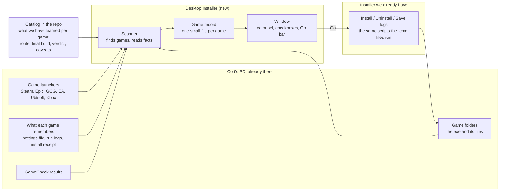

# Desktop Installer: build-ready plan

Written by Claude (Fable), 2026-11-20, at Cort's request: "add to the documentation and descriptions. How best to code and enable smooth function. Is there a free 3rd party program which would be useful to power it? I want the carousel to work smoothly as butter. I want the program to know everything it needs to know about the games in it. Don't build it but get it ready for building."

**Status: plan only. Nothing here is built, and nothing is to be built until Cort says go.**

This page builds on Astra's approved design, [INSTALLER-CAROUSEL-DESIGN.md](INSTALLER-CAROUSEL-DESIGN.md) (2026-10-29), and her installer audit, [BROAD-NATIVE-DLSS-INSTALLER-AUDIT-20261031.md](BROAD-NATIVE-DLSS-INSTALLER-AUDIT-20261031.md) (finding F1). Her design is unchanged: what the window looks like and how it behaves is hers and Cort's. This page adds what a builder needs on top of it: what to build it with, how to make the carousel smooth, what the program knows about each game, how it uses the installer we already have, and the order to build it in.

A picture version of this plan, with a moving carousel sketch, is linked from the pull request.

---

## 1. The whole thing in one picture

In words: the scanner looks at the PC and writes one small record per game. The window only ever reads those records, so it opens instantly and never waits on a disk. Pressing Go hands the game's folder and exe to the install script we already trust. Nothing about a game is written into program code; it all arrives as data.

Three kinds of knowledge feed a game's record, and the record always says which kind a fact is:

| Kind | Where it comes from | How much we trust it |
|---|---|---|
| **Seen on disk** | The scanner reading the game's own files | A strong hint. Tells us what a game can do, not what it does. |
| **Seen running** | The logs our program wrote the last time the game ran | Fact. This is what actually happened. |
| **Confirmed by Cort** | GameCheck verdict, scorecard, final-builds table | The final word. Only this turns a game green. |

This is the same rule GameCheck already follows: unknown is not a pass.

---

## 2. What to build it with

### Recommendation

**Tauri 2 for the program, with the window written as an ordinary web page (HTML and CSS), drawn by WebView2.** All free.

Why this one:

1. **It reuses what Cort already approved.** The approved mockup is an HTML page and the Poise font already ships as web font files (`design/poise/fonts/*.woff2`). With a web-page window, the approved design becomes the real window instead of being redrawn from scratch in another toolkit.
2. **Smoothness comes built in.** WebView2 is the Chromium engine that is already part of Windows 11. It moves and fades pictures on the graphics card, on its own track, separate from the program's other work. Tilted cards in depth, fading and blur are things it does natively. That is exactly what the carousel is.
3. **It reuses the game-finding code Astra already pointed to.** Tauri's working half is written in Rust, the same language as the MIT-licensed [DLSS5oneclick](https://github.com/faisalkindi/DLSS5oneclick) library and game-folder inspection named in Astra's design. That code can be studied or adapted directly, with its notice kept.
4. **Small and self-contained.** One program of roughly 10 MB. No runtime to install on Windows 11.
5. **Nothing new on Cort's PC to build it.** GitHub's build machines (which already build our program on every change) can build the installer too. Cort downloads the finished program. No new tools installed, and no compiling on the PC that has logged processor errors.

### What was weighed against it

| Option | Free? | Why not first choice |
|---|---|---|
| **egui** (what DLSS5oneclick uses) | Yes, MIT / Apache-2.0 | Great for plain panels. Tilted, blurred, fading cover art would all be hand-built, and the approved HTML design would be redrawn by hand. |
| **Dear ImGui** (already in our repo for the Home menu) | Yes, MIT | Same problem as egui, more so. Right tool for the in-game menu, wrong tool for an artwork carousel. |
| **Our own C++ window hosting WebView2** | Yes | The fallback. Same web-page window, same smoothness, stays in our existing C++ build. Loses the ready-made Rust game-finding code. Because the window is a web page either way, switching between this and Tauri later costs little. |
| **Electron** | Yes, MIT | Works, but ships a whole browser: around 150 MB and slower to open. Tauri gets the same result with the browser Windows already has. |
| **Qt** | Free under LGPL with conditions | Capable, but large, a new toolkit for everyone, and licence conditions to manage. |
| **WinUI 3 / WPF** | Yes, MIT | Capable. Brings a second programming language and none of the reuse above. |
| **Slint** | Free under GPL or a royalty-free licence with conditions | Good toolkit, licence terms add a decision we do not need. |

### The free building blocks

Licences below are as I know them today. **Each one is confirmed against the project's own licence file at Stage 0 before it is added**, and recorded in `third_party/README.md` the way the others are.

| Job | Building block | Licence | Notes |
|---|---|---|---|
| Program shell and window | **Tauri 2** | MIT or Apache-2.0 | |
| Drawing the window | **WebView2** (Microsoft) | Part of Windows 11; Microsoft's runtime terms | Not bundled, already present |
| Carousel motion | **None needed.** The browser's own transforms and the page's frame clock | | About 150 lines of our own page script. No animation library to start with. |
| Finding Steam games | `steamlocate` | MIT | Reads Steam's library list and each game's install record |
| Finding Epic, GOG, EA, Ubisoft, Xbox games | Adapted from DLSS5oneclick `library.rs` | MIT | Each launcher keeps a list on disk or in the Windows registry |
| Reading a game's exe (32 or 64-bit, which DirectX it asks for) | `goblin` or `pelite` | MIT | The same check `deploy-native11.ps1` already does for 32/64-bit, extended |
| Reading the Windows registry | `winreg` | MIT | For GOG and other launchers |
| Shrinking cover pictures for the cache | `image` | MIT or Apache-2.0 | |
| Font | **Poise** (Astra, from Jost) | SIL OFL 1.1 | Already in `design/poise/` |

### Cover art and game facts: where they come from

Order matters. The first source that has the answer wins, and the PC's own files come first so the program works with no internet.

| What | First choice | Then | Last resort |
|---|---|---|---|
| **Cover art** | The picture the launcher already saved on the PC. Checked on Cort's PC 2026-11-20: Steam keeps one folder per game id under `Steam\appcache\librarycache\`, each with an upright cover `library_600x900.jpg` (300 by 450 pixels as stored), a wide banner, a logo and a ready-blurred backdrop. Epic and GOG keep theirs too (not yet checked) | The launcher's public picture address for that game id | [SteamGridDB](https://www.steamgriddb.com) (free, needs a free personal key, community-made art), then a plain Poise title card |
| **Name, launcher id, install folder** | The launcher's own record on disk | | |
| **DirectX kind, 32/64-bit, DLSS and Frame Gen files, anti-cheat** | The game's own files (section 4) | Our run logs | |
| **Hints for games we have never run** | [PCGamingWiki](https://www.pcgamingwiki.com) (free to read; its text is CC BY-NC-SA, so we link and summarise, we do not copy) | | |

Two rules for anything from the internet: it is only ever a **hint** shown as "not tried yet", never a green light; and the program must work fully with the network unplugged. Sync is the only thing that goes online, and only when pressed.

**Cover art and release.** For Cort's own PC, using the launcher's saved covers is the launcher's normal use. If this program is ever shared publicly, it should fetch covers on the user's PC the same way and ship none of its own. That keeps other people's artwork out of our download.

---

## 3. How the carousel is made butter-smooth

Smooth means one thing: every time the monitor refreshes, a new picture is ready. At 144 refreshes a second that leaves about 7 thousandths of a second each time. The whole design below is about never doing anything slow inside that window.

### The seven rules

1. **Only move, turn and fade.** Cards change only their position, angle and transparency. The graphics card does those three without redrawing the picture. Nothing in the carousel ever changes size, layout or text while moving.
2. **One number runs the show.** The carousel has a single position, like a dial: 3.0 means game three is in front, 3.5 means halfway to game four. Each card's place, tilt, fade and stacking order is worked out from how far it is from that number. One number in, nine cards out. This is what makes drag, arrows, keyboard and mouse wheel all feel identical, as Astra's design asks.
3. **A spring, not a timer.** Pressing an arrow moves the *target*. The position chases the target like a soft spring and settles in about a quarter of a second with no bounce. Press five times quickly and it simply glides further; nothing queues up and nothing snaps. Letting go of a drag carries on with the speed of your hand, then settles on the nearest game.
4. **Blur is prepared, never computed live.** Live blur is the one costly effect in the approved look. So each cover is saved twice in the cache: sharp, and already soft and dark. Side cards cross-fade between the two. Same look, no cost while moving.
5. **Pictures are ready before they are needed.** Covers are shrunk once to the exact size they are shown at, saved in the cache, and unpacked into graphics memory ahead of time for the games just out of view. A picture is never unpacked while the carousel is moving. A game with no art yet shows its name on a Poise card and swaps quietly when the art arrives.
6. **Eleven cards, however many games.** Nine are visible (the selected one and four each side, per the approved mockup) plus one spare each side. As the carousel turns, cards leaving one end are reused at the other. A library of 20 games and one of 2,000 cost the same.
7. **The window does nothing but draw.** Finding games, reading files, checking compatibility and installing all happen in the program's working half, in the background. The window is told when something changes. A slow disk can never make the carousel stutter.

### Smaller details that matter

- The frame clock follows the monitor, so 60, 144 and 240 Hz all work without settings. Motion is worked out from elapsed time, never from a count of frames.
- A click or key press starts motion on the very next frame. No waiting for a double-click or a previous move to finish.
- The Go bar's colour for a newly selected game appears as soon as the card lands, from the cached record. "Checking compatibility..." (Astra's suggestion 6) shows only on a game's very first scan.
- The first and last game: stop softly at the ends, with a small give. This was left open in Astra's design; it is a one-line change either way and is Cort's call when he sees it.
- Windows' "reduce motion" setting is honoured: cards change places with a quick fade instead.

### How we will know it is smooth (no eyeballing numbers)

The window has a built-in **smoothness log**. A test command spins the carousel through 100 games by itself and writes every frame's time to a file, with a plain summary line: monitor rate, slowest frame, how many frames were late, and what the program was doing during any late one. Cort never reads numbers off the screen; the log goes with the other results. The pass mark is in section 6.

---

## 3a. The approved look, written down (Astra's Proposal 04)

The original mockup file was lost from Cort's PC. On 2026-11-20 Cort supplied a picture of it ("The top part is the UI. The bottom is an explanation") and said of an earlier plain sketch: "it doesn't look how i want it. Astra had a better UI look. Light reflections of the game art." This section records that look in words and numbers so it survives. The picture is kept in the project's shared files as `installer-plan/astra-proposal-04.png` (not in the repo, because it shows game cover art). A working rebuild is on the picture page linked from the pull request.

**Top to bottom**

1. Header: "NeuralAlias" in Poise Light at the left; "Library" (underlined, current), "Components", "Settings" at the right; a hairline beneath.
2. Headline, centred: "Your games. Sharper and smoother." in Poise Light. Beneath it: "Bring DLSS, Neural Rendering and Frame Generation to your games."
3. At the right, above the carousel: the game count ("9 games") and a round Sync button with two circling arrows.
4. The carousel (below).
5. The selected game's name in Poise Light, and a small line: "Saved library information · DX12".
6. Two small square arrow buttons with a counter between them: "05 / 09".
7. The Go bar: 300 px wide, centred.
8. One box titled "Installation Options" holding three checkboxes in a row: DLSS, DLSS 5 Neural Rendering, Frame Gen. A feature the game already has is shown ticked and gray with "Already in game" beneath it. Below the box: "1 feature selected".
9. Footer hairline with small notes.

**Colours** (sampled from the picture)

| Use | Colour |
|---|---|
| Window background | `#111716` |
| Text | `#f2f2ea`, muted `#9ea8a1` |
| Go, ready | `#b7cf97` with dark text `#243022` |
| Go*, with caveats | `#e2c685` with dark text |
| Unable to Install* | `#b8645e` with white text |
| Nothing selected, on hover | `#7d877f` with white text |
| Explanation strip | paper `#edf0e8`, dark text |
| Selected cover's frame | cream `#f1efe4`, 3 px |
| DirectX ribbon | pale sage, dark text, across the top-left corner |

**The carousel, measured from the picture** (selected cover 220 by 328)

| Places from the middle | 0 | 1 | 2 | 3 | 4 |
|---|---|---|---|---|---|
| Distance from centre | 0 | 228 | 324 | 406 | 472 |
| Size | 100% | 90% | 76% | 63% | 52% |
| Turned toward the middle | 0° | 33° | 36° | 38° | 40° |
| Dimmed and softened | none | slight | more | more | most, fading out |

So there is breathing room beside the selected cover and the side stacks tighten and fade, as Astra's handoff note said. Covers are centred on one line (no floor), each with a soft shadow, rounded corners and a fine light edge. Side covers and the arrows both move one game.

**The light on the art.** Covers look glossy: a soft band of light lies across each one and moves as the cover turns. To keep this free of cost while moving, the band is one ready-made strip per card that the graphics card only slides (rule 4 in section 3). The same goes for the dim, soft side covers.

**The action bar explanation** (the lower part of Astra's picture) is kept word for word: Ready: "The selected features can be installed." With caveats: "Hover or select * to read the specific caveats." Unavailable: "Explain which selection cannot work, and why." Nothing selected, hover: "'Please make a selection' appears above the bar." Also: "Compatibility follows selected features. While detection runs: 'Checking compatibility…' · Uninstalled overlay options remain visible, grayed out and labelled 'Not installed'." Sync: the first scan reports what it found; later scans stop silently.

---

## 4. What the program knows about each game

One record per game, kept as a small file in `%LOCALAPPDATA%\NeuralAlias\library\`. Every fact carries **where it came from** and **when**, so a guess can never pass for a fact.

### The record

| What it knows | How it finds out | Refreshed when |
|---|---|---|
| **Name and launcher** | Launcher's own record | Sync |
| **Install folder** | Launcher's own record | Sync |
| **The real game exe** | Launcher's record names it. Where a launcher exe starts the real game, the true one is learned from our own startup log after the first run | Sync, then after a run |
| **32-bit or 64-bit** | Read from the exe's header (the check our install script already does) | When the exe changes |
| **DirectX 9, 11, 12 or Vulkan** | Disk: which graphics files the exe asks for. Often more than one, so the record lists candidates. Fact: the API our program actually started on, from the startup log | Disk on Sync; fact after each run |
| **Game ships DLSS** | Disk: `nvngx_dlss.dll` present, with its version. Fact: run log shows the game calling it | Sync, then after a run |
| **Game ships Frame Gen** | Disk: `nvngx_dlssg.dll` and the Streamline files. Fact: run log | Same |
| **Other upscalers present** (FSR, XeSS) | Disk: their files | Sync |
| **Anti-cheat risk** | Disk: the well-known anti-cheat folders and files, matched from a signature list kept as data. Also notes when a game has a separate single-player exe with none | Sync |
| **Another add-on already in the way** | Disk: a `dxgi.dll` or similar in the game folder that is not ours (the install script already refuses to overwrite one) | Sync and again at Go |
| **Is the game running right now** | Asked at the moment Go is pressed | Live |
| **Our route** (A: game ships DLSS; B: we add it) | Worked out from the facts above | Whenever they change |
| **Which input provider** (DX12, native DX11, 32-bit with companion) | Worked out from API and 32/64-bit | Same |
| **What is installed now** | The install receipt our script already writes (`manifest.json`: build, files, 32/64) | After every install or uninstall |
| **Final build for this game** | The catalog (below) | When the catalog changes |
| **Verdict and numbers** (stable or not, DLAA frames, fps) | GameCheck's saved results | After each imported run |
| **Known caveats** (for example, the game's own temporal AA cannot be turned off) | The catalog | When the catalog changes |
| **Settings the game remembers** | Not copied. The record only points at the game's own `NeuralAliasHost.ini` | Never duplicated |

A change check keeps this fast: the scanner looks at a file's size and date first and only re-reads the file when those have moved.

### The catalog: what we have learned, as data

The scanner covers what can be seen. What we have *learned* (route, final build, caveats) lives in one place in the repo, as data files, and travels with the installer:

- **It is built from what already exists**, not typed again: `growth/cases/*.json` (game, route, API, provider), `growth/floors/`, GameCheck's results, and the "Final builds per game" table in MASTER-PLAN.md made machine-readable. The table stays the page people read; the data file is generated beside it.
- **A game is matched to its catalog entry by launcher id and exe fingerprint, which are data.** Program code never contains a game's name. A check in CI, in the spirit of `scripts/check_variants.py`, fails the build if a game name or exe name appears in the installer's code.
- **A game with no catalog entry still works.** It shows what the scanner saw, a yellow "not tried yet", and installs as a first-contact run. That is Cort's generality test, built into the front door: a new game needs no new code and no new catalog entry to be tried.

### How the Go bar picks its colour

The colour answers "for the boxes ticked right now", as Astra's suggestion 3 asks.

| Colour | Shown when | Hover / asterisk text comes from |
|---|---|---|
| **Green, Go** | Confirmed by Cort for the ticked features on this game's final build | "Ready to install" plus the build |
| **Yellow, Go\*** | Should work but not confirmed; or works with a known caveat; or never tried | The caveats in the catalog, or "Not tried yet on this game" |
| **Red, Unable to Install\*** | Something on disk rules it out: an anti-cheat that blocks add-ons, an API we have no provider for, a feature with no working route | The exact fact and where it was seen |
| **Gray** | Nothing ticked ("Please make a selection"), or the game is running ("Close the game first") | |

A checkbox for a feature with no route on this game is shown grayed with its reason, so the bar never has to turn the whole game red over one feature.

### Sync

Sync re-reads the launchers and game folders in the background, as approved in the v4 mockup: the arrows spin, and it reports only what it added ("2 new games"). It never blocks the carousel and can be cancelled. Without Sync the program still opens straight from the cache.

---

## 5. How it uses the installer we already have

**The Desktop Installer installs nothing by itself.** It is a front door. Go runs the same install script that the numbered `.cmd` files in each package run today.

| Button | What actually runs | Already exists? |
|---|---|---|
| **Go** | The install script's Deploy, with the game's folder, exe and label passed in | Yes: `tools/deploy-native11.ps1` already takes the game as a parameter ("the game is a parameter, never code"); `scripts/consolidated-install.ps1` does Install / Rollback / Status / Results / Validate |
| **Uninstall** | Rollback | Yes |
| **Save logs** | Results | Yes, the same folder GameCheck imports |
| **Status on the card** | Reads the receipt the script wrote | Yes |

What this keeps, for free: the script refuses to overwrite a game's own files, records exactly what it added, removes exactly that, checks every file's fingerprint before use, refuses a 32-bit program on a 64-bit game, and writes the build hash where Cort can confirm it. None of that is rewritten.

What has to change in the existing scripts, and no more:

1. **One script for both routes.** Today DX12 packages carry their own `deploy.ps1` and native DX11 uses `deploy-native11.ps1`. Astra's audit (F1) already asks for one parameterised transaction and one release manifest. That work is the foundation for this program and is worth doing even without the window.
2. **A machine-readable answer.** The script adds one line of structured result (worked, or the exact reason it stopped) so the window can show the same message the log has.
3. **Feature choice as a parameter.** The three checkboxes become three switches on the script, so "do not install unselected features" is enforced by the installer itself, not by the window.

**Where builds live.** Each game currently has its own final build. The installer keeps builds in one store on the PC, one folder per build hash with the existing `package.json` (file fingerprints) inside, and installs the build the catalog names for that game. When one build is final for every game, the store simply holds one. The NVIDIA DLSS file is taken from the SDK folder already on Cort's PC, as packages do today; it is never committed.

**Per-game memory stays where it is.** The program in the game already remembers its settings per game in `NeuralAliasHost.ini`, and run logs and receipts already sit under `%LOCALAPPDATA%\NeuralAlias\runs\`. The Desktop Installer reads those. It does not keep a second copy of any setting, so there is never a question of which copy is right. Every in-game setting stays live in the Home menu with no restart; the Desktop Installer adds no setting that needs one.

**One program.** The Desktop Installer is a separate, small program, like GameCheck: never loaded by a game, and the game program runs without it. It always installs the one NeuralAlias program, whichever game and API. The numbered `.cmd` files keep working beside it, so a test package never depends on the window.

**In-game menu.** Per Astra's design, features that were not installed stay visible in the Home menu, grayed, labelled "Not installed". The install receipt already says what was installed; the Home menu reads that. One small change, in the stage that wires Go.

---

## 6. Build order, and what "done" means at each step

Each stage ends in something Cort can see or a log he can hand over. No stage starts until the one before it passes. All of it lands on the shared code line through short branches, per the no-sprawl rule.

| Stage | What is built | Done when |
|---|---|---|
| **0. Settle the choices** | Nothing built. Cort says yes or no to Tauri plus a web-page window. The v4 mockup is put into the repo (see open items). Licences confirmed. Astra and Sol agree the record and catalog fields. | Cort's go; mockup in `design/installer/`; one licence table |
| **1. One install script for any game** | The existing transactions folded into one script with the game as a parameter, a structured result line and the three feature switches (Astra's F1). No window. | For each game with a final build, the new script leaves the game folder and receipt identical to today's package, and uninstall restores it exactly. Checked by fingerprints in a log. |
| **2. The scanner, as a command with no window** | Finds games across the launchers on the PC and writes the records and a plain report. | On Cort's PC the report lists every installed game with the right folder, exe, 32/64-bit, DirectX candidates and DLSS/Frame Gen files, and says why for anything it skipped. The no-game-names check passes in CI. |
| **3. The carousel, looking only** | The window with real covers, the approved layout, arrows, drag, keys. Go does nothing yet. | The smoothness log from a 100-game spin on Cort's monitor shows **no late frames**, and Cort, seeing it, says it is smooth and matches the mockup. |
| **4. The Go bar tells the truth** | Records plus catalog plus GameCheck results drive the colour, the hover text and the grayed checkboxes. Still installs nothing. | Every game on the scorecard shows the colour and reason the scorecard gives. A game we have never tried shows yellow "not tried yet", never green. |
| **5. Go installs** | Go, Uninstall and Save logs call the Stage 1 script. Home menu shows "Not installed" for unticked features. | Installing from the window gives the same result as the package's `.cmd` for the same build; the game starts with the Home menu showing; Uninstall leaves the game folder as it was. |
| **6. Sync and the round trip** | Sync button; after a play session, saved logs flow into GameCheck and the card's verdict updates. | A new game installed on the PC appears after one Sync. A game never seen before (the Pharaoh test) can be tried from the window with no new code. |
| **7. One download** | The window, the scanner, the script and the build store packed as a single download built by CI. | Cort installs it once from one file, and the hash shown in the window matches the one in the install log. |

Stages 1 and 2 need no window and help today's test packages by themselves, so they are safe to do first whenever Cort gives the word.

**Suggested owners, for Astra and Sol to answer in COMMS:** Astra, design owner and review of the window against her design; a Claude thread builds the scanner, the window and the catalog generator; Sol, the single install script, the build store and the merge.

---

## 7. Open items

1. **The original Proposal 04 file is still missing** from `Documents\NeuralAlias-Installer-Proposal-v4\` on Cort's PC (checked 2026-11-20) and was never in the repo. Cort supplied a picture of it the same day; section 3a records the look from that picture. **Astra, if you still have the HTML file, please commit it to `design/installer/`** so Stage 3 can start from your file instead of a rebuild.
2. **Stack choice** is Cort's: Tauri plus web page (recommended) or the C++ fallback.
3. **Wraparound at the ends**, checkbox defaults and exact timing stay Cort's calls on seeing Stage 3, as Astra's design left them.
4. **Sharing beyond Cort's PC** raises two questions that do not block building: where the NVIDIA DLSS file comes from on someone else's PC, and signing the program so Windows does not warn. Both wait until a public release is on the table.
5. **Route B today is DLAA only**, with added upscaling held off by the master switch. The DLSS checkbox and the Go bar reflect whatever the master switch allows at the time; the window never promises more than the build delivers.
